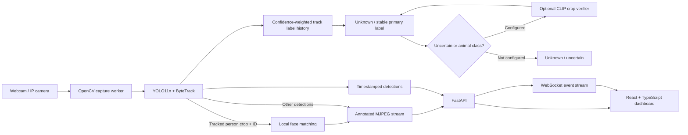

# SentinelAI

Local-first, real-time home monitoring with camera capture, object tracking, optional local face recognition, and a web dashboard. Processing runs on the machine hosting the backend; SentinelAI does not record continuous video.

## Architecture



The backend is organized into camera lifecycle management, isolated video workers, event transport, and an HTTP/WebSocket API. The frontend consumes those APIs and displays actual camera frames and detection events. Model inference and camera credentials remain on the host. The server binds to loopback by default.

## Project structure

```text
backend/
  app/
    main.py                 FastAPI routes and application lifecycle
    schemas.py              API request and event models
    settings.py             Environment-based inference settings
    services/
      camera_manager.py     Camera lifecycle and WebSocket event fan-out
      biometric_store.py    Encrypted local enrollment embeddings/history
      face_recognition.py   YuNet detection, SFace embeddings, conservative matching
      people_store.py       Local SQLite people directory and review records
      video_processor.py    OpenCV capture, YOLO inference, ByteTrack
  scripts/
    evaluate_yolo_dataset.py  Metrics on labeled YOLO-format datasets
  tests/
frontend/
  src/
    App.tsx                 Live monitoring dashboard
    style.css               Responsive dashboard styles
```

## Model choices and implementation plan

- **Phase 1 (implemented):** OpenCV camera capture, Ultralytics `yolo11n.pt` object detection, Ultralytics' ByteTrack integration, annotated MJPEG feeds, and timestamped WebSocket updates.
- **Classification safeguards (implemented):** The detector's class must persist across multiple observations of a tracked object and pass confidence/support thresholds. Until then the API emits `unknown`, preserves the raw model suggestion separately, and does not present it as a final class. Animal and weapon-like labels (`bird`, `cat`, `dog`, `knife`, `baseball bat`, `scissors`) require secondary verification by default; without a configured verifier, they remain unknown.
- **Temporary object memory (implemented):** Each tracked object exposes first/last frame seen, total observation count, bounded recent label/confidence/verification history, and image-plane movement in pixels. Memory resets after a camera reconnect and expires when the track disappears.
- **Optional crop verification (implemented, opt-in):** Configure a Hugging Face CLIP model to compare only stabilized uncertain/animal detections with COCO labels and household alternatives including broom, mop, and bucket. Disagreement or a weak score/margin yields `unknown`; CLIP never replaces YOLO's label with its own alternative. Scores are similarity evidence, not calibrated probabilities.
- **Phase 2 (implemented):** Named, per-camera polygon zones can be drawn and edited over live feeds. Entry/exit use tracked-object geometry, a minimum one-second track age, two-frame confirmation, configurable short-loss tolerance, and a 30-second per-track event cooldown. Loitering defaults to 30 seconds per zone and fires once per continuous stay. Person positions use the bottom-center of the box; other objects use its center. Zone events are geometric rule outputs and do not assign suspicion or depend on the model's final class.
- **Person identity overlay (implemented):** YOLO11n and ByteTrack continue to detect and track people; local face matching labels the same track only after threshold and ambiguity checks pass. The annotated feed shows `Name | Resident`, `Name | Visitor`, or `Name | Staff`; pending, face-not-visible, and uncertain outcomes show `Identifying...`, `Person | Face Not Visible`, and `Unknown Person`. Statuses have distinct colors, and identity caches are cleared when a track expires, the camera reconnects, or profiles change.
- **Phase 3:** Optional, independently processed audio events; audio capture and any transcription must be explicitly enabled.
- **Phase 4:** Correlate time-aligned observations with transparent rule-based fusion; model-generated explanations will remain distinct from sensor observations.
- **Local people management and recognition (implemented, opt-in/configured):** The dashboard supports residents, visitors, and authorized staff; profile edits and deactivation; consent-gated enrollment; encrypted face embeddings; tracked face matching; unknown/uncertain states; consent withdrawal; and recognition history. Enrollment photographs are decoded and processed locally and are not retained.
- **Recognition models:** OpenCV Zoo YuNet for face detection and SFace for embeddings. YuNet model files are MIT-licensed and SFace model files are Apache-2.0 in their respective OpenCV Zoo directories. SFace is **not ArcFace**. InsightFace's Python library code is MIT, but its bundled pretrained models are marked for non-commercial research only; this project does not use those weights.
- **Privacy controls:** The dashboard has no login, so the backend restricts HTTP APIs, camera feeds, and the event WebSocket to loopback clients and defaults to `127.0.0.1`. Do not expose the service to other devices or networks. Embeddings are encrypted with Fernet using a separate key from `.env`; raw images and embeddings are never returned by the API or logged.
- **Phase 5:** Authentication, authorization, retention controls, migrations, and broader reviewable alert/event history.
- **Phase 6:** Extend the dashboard with zone configuration, event search, review workflows, and notification settings.
- **Phase 7:** Integration tests, latency/false-positive evaluation, and deployment hardening.

The configured `yolo11n.pt` weight exposes 80 COCO classes. The installed model metadata confirms it includes `bird` but does not include `broom`, `mop`, or `bucket`; it must map unfamiliar objects to a supported class or miss them. Ultralytics applies its standard letterbox preprocessing; inference size, NMS IoU, and detector threshold are explicit settings. There is no vision-language model or LLM in the application. Face matching runs only on YOLO person crops with ByteTrack IDs, at a configurable interval on a background worker; a name is emitted only after the configured similarity and ambiguity checks pass. No clothing- or body-based identity matching is used.

The safeguards reduce unsupported certainty; they do not prove an accepted label is correct. The default policy is intentionally conservative for bird/cat/dog: those labels are withheld unless secondary verification is enabled and agrees with YOLO.

## Run locally

Requirements: Python 3.10+, Node.js 18+, and a webcam or accessible camera stream. On first backend startup, Ultralytics may download the configured model weights.

1. Copy `.env.example` to `.env` if you want to customize backend settings. The backend loads that file at startup; shell environment variables take precedence. The dashboard has no login; the backend rejects non-loopback clients. Keep the backend and frontend bound to this device only. `SENTINEL_CONFIDENCE` controls candidate detection, while `SENTINEL_MIN_CLASS_CONFIDENCE`, `SENTINEL_TEMPORAL_MIN_OBSERVATIONS`, and `SENTINEL_TEMPORAL_MIN_SUPPORT` control when a label can become final. Zone rules are configured with `SENTINEL_ZONE_MIN_TRACK_AGE_SECONDS`, `SENTINEL_ZONE_ENTRY_FRAMES`, `SENTINEL_ZONE_EXIT_FRAMES`, `SENTINEL_ZONE_LOITER_SECONDS`, `SENTINEL_ZONE_EVENT_COOLDOWN_SECONDS`, `SENTINEL_ZONE_TRACK_LOSS_TOLERANCE_SECONDS`, and `SENTINEL_ZONE_TRACK_MATCH_DISTANCE_FRACTION`; loiter duration and cooldown can also be set per zone in the dashboard.
2. In a terminal:

   ```powershell
   cd backend
   py -m venv .venv
   .\.venv\Scripts\Activate.ps1
   pip install -e ".[dev]"
   python -m app
   ```

3. In a second terminal:

   ```powershell
   cd frontend
   npm install
   npm run dev
   ```

4. Open the Vite URL (normally `http://127.0.0.1:5173`) and add a camera. Use `0` for the default webcam, or enter an IP camera stream URL.

For PowerShell environments that restrict script activation, run `.\.venv\Scripts\python.exe -m pip install -e ".[dev]"` and `.\.venv\Scripts\python.exe -m uvicorn app.main:app --host 127.0.0.1 --port 8000` from `backend`.

Run backend tests from `backend`:

```powershell
pytest
```

### Optional crop verifier

The default settings keep animal and weapon-like detections unclassified unless an independent crop verifier agrees. The verifier result is cached per track and candidate label for 90 processed frames (configurable with `SENTINEL_VERIFIER_CACHE_TTL_FRAMES`) then recomputed if needed. To enable it, install the optional package and set the verifier model in `.env`:

```powershell
pip install -e ".[verification]"
```

```dotenv
SENTINEL_VERIFIER_MODEL=openai/clip-vit-base-patch32
```

The first configured start downloads the verifier weights. It runs only for stabilized track classifications that are animals or below the high-confidence threshold, then caches the result for that tracked object. CPU inference can add latency; increase `SENTINEL_FRAME_INTERVAL` or leave the verifier disabled if the camera cannot keep up. `SENTINEL_IMAGE_SIZE=960` can help with small objects at increased inference cost; benchmark on your hardware. Similarity thresholds require calibration against your own validation set.

### Labeled evaluation

Provide a labeled dataset in YOLO format and follow [the evaluation guide](backend/evaluation/README.md). Run from `backend`:

```powershell
python -m scripts.evaluate_yolo_dataset --images path\to\images --labels path\to\labels --class-map path\to\classes.json --output output\metrics.json
```

The evaluator reports class precision/recall/F1, confusion matrix, unknown rate, average latency, and clearly defined image/object error rates. Use the same thresholds and model for baseline and candidate runs. No labeled dataset was supplied with this project, so no measured before/after accuracy claim is available.

## Person records, enrollment, and face recognition

The default SQLite database is `backend/data/sentinelai.sqlite3`; set `SENTINEL_DATABASE_PATH` to choose another path. The database and its directory are created on backend startup.

### Configure local recognition

1. Generate a Fernet key from the backend environment and set the printed value as `SENTINEL_BIOMETRIC_KEY` in `.env`:

   ```powershell
   cd backend
   .\.venv\Scripts\python.exe -c "from cryptography.fernet import Fernet; print(Fernet.generate_key().decode())"
   ```

   Keep this key separate from the SQLite database and private. If it is lost, the stored embeddings cannot be decrypted; affected people must be enrolled again.
3. Download the ONNX models from the official [YuNet model directory](https://github.com/opencv/opencv_zoo/tree/main/models/face_detection_yunet) and [SFace model directory](https://github.com/opencv/opencv_zoo/tree/main/models/face_recognition_sface). Put the files at the configured `SENTINEL_YUNET_MODEL_PATH` and `SENTINEL_SFACE_MODEL_PATH` paths (default paths are under `backend/models/`). Do not use InsightFace model zoo weights unless their licensing separately authorizes your use.
4. Restart the backend and open the dashboard. Create a person with a category, expand the profile, select 2–8 clear enrollment photos, and confirm informed consent before enrolling. Photos should show one face each, from more than one angle/lighting condition. Photos are processed in memory and discarded; only encrypted embeddings are stored.

The system analyzes person crops asynchronously, with the interval controlled by `SENTINEL_RECOGNITION_INTERVAL_FRAMES`; it caches results per camera track, rechecks verified tracks periodically, and discards track associations after tracker expiration, camera reconnect, or a profile change. While matching is pending, the feed shows `Identifying...`; a missing face shows `Person | Face Not Visible`; and uncertain, ambiguous, or below-threshold results show `Unknown Person`. Only a verified match displays a registered name with its category. Unknown does not imply suspicious. Similarity scores are not probabilities.

The default similarity threshold is a conservative starting configuration, **not a calibrated threshold**. This repository does not include a consented, labeled face-recognition validation set, so no false-acceptance, false-rejection, or accuracy claim is made. Calibrate thresholds using representative, consented footage before relying on identity output. The current OpenCV face-model adapter runs on CPU; setting `SENTINEL_RECOGNITION_DEVICE` to another value disables recognition instead of silently falling back. The app does not infer emotion, gender, ethnicity, or threat level.

The dashboard has no login. All HTTP and WebSocket requests are restricted to loopback; do not expose the service to a shared or remote network. Withdrawing consent or deleting a profile removes its embeddings, clears linked recognition-history identity/similarity, and invalidates live track caches. Saved review records remain, but any matching recognition labels are scrubbed. Face recognition is only local. Protect `.env`, the database, and the host account.

The implemented face-related routes are `POST/GET /api/people`, `GET/PUT/DELETE /api/people/{person_id}`, `POST /api/people/{person_id}/enroll`, `POST /api/people/{person_id}/consent/withdraw`, `GET /api/recognition/status`, and `GET /api/recognition/events`. They are available only from the local machine. Raw embedding values are never included in responses.

### Detection review

Live detection updates remain transient unless a user chooses **Save for review**. A saved item contains the camera name/ID, timestamp, and structured detection results, not a frame, crop, or video clip. A reviewer can mark it reviewed and optionally manually associate a directory record. Deleting a person removes that association and scrubs any saved automatic recognition label while preserving the review record.

## Current scope and safety

The application does not persist every detection update, record clips, send email/push notifications, or perform audio analysis. Because the dashboard has no login, this app is intended for local use only. Do not bind it to a public interface or expose its API or camera feeds to other devices.

Camera feeds can contain credentials. Prefer a camera URL configured through a secured local environment and avoid sharing logs, screenshots, or URLs that reveal credentials. This phase sends no speech to a transcription service and does not store raw video.
